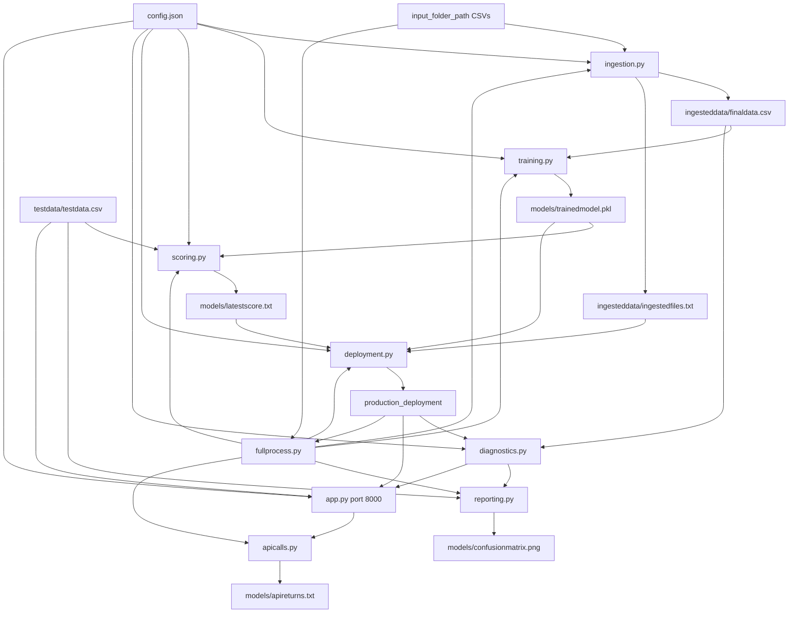
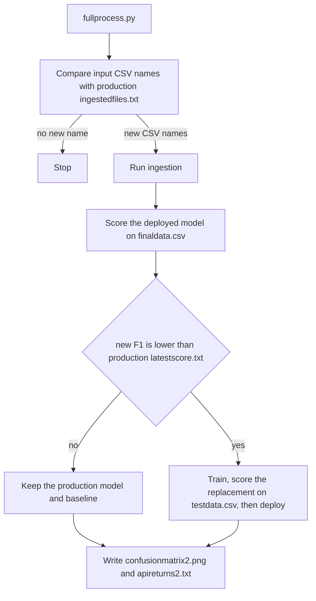

# Architecture

A Dynamic Risk Assessment System predicts whether a corporate client will leave a contract. The column `exited` is 1 when the client left and 0 when the client stayed. About 10,000 clients is the business setting. The supplied files are a small fabricated sample of that problem.

The model is logistic regression. Its only inputs are:

```text
lastmonth_activity
lastyear_activity
number_of_employees
```

`corporation` is an identifier. It is ingested and included in missing-data checks, and it is excluded from training, scoring, and prediction.

Every directory comes from `config.json`. `common.load_config()` reads that file when a function runs, so a script picks up the current paths instead of freezing them at import time.

## How the pieces fit



Candidate artifacts and production artifacts are separate. Training and scoring write under `output_model_path` (`models` in the final configuration). Deployment copies three files into `prod_deployment_path`. Diagnostics, the API, and the confusion matrix read the production model. They do not deploy.

## Runtime paths

| Path | Written by | Read by |
| --- | --- | --- |
| `sourcedata/*.csv` | Supplied data | `ingestion.py`, and `fullprocess.py` when it looks for new names |
| `ingesteddata/finaldata.csv` | `ingestion.py` | `training.py`, drift scoring, summary and missing-data diagnostics |
| `ingesteddata/ingestedfiles.txt` | `ingestion.py` | `deployment.py` |
| `testdata/testdata.csv` | Supplied data | Candidate scoring, `/scoring`, `/prediction` from `apicalls.py`, confusion matrix |
| `models/trainedmodel.pkl` | `training.py` | `scoring.py`, then `deployment.py` |
| `models/latestscore.txt` | `scoring.py` when a score path is passed | `deployment.py` |
| `production_deployment/` | `deployment.py` | Predictions, `/scoring`, drift comparison |
| `models/confusionmatrix.png` and `apireturns.txt` | First reporting run | Kept when the second run writes the `2` files |
| `models/confusionmatrix2.png` and `apireturns2.txt` | `fullprocess.py` after new data | Submission pair for the second run |

`validation_data/no_drift/no_drift.csv` and `validation_data/drift/drift.csv` are eight-row fixtures with the same features and opposite labels. They are not part of the default input folder.

## Decision flow

`fullprocess.py` is the scheduled job. `cronjob.txt` runs it every 10 minutes.



An equal F1 is the no-drift branch. The drift score is calculated in memory. `score_model` writes a file only when `score_path` is set, so the drift check and `/scoring` cannot overwrite the production baseline.

The replacement model is scored on `testdata/testdata.csv` before deployment. `deployment.py` then copies that new pickle, the new `latestscore.txt`, and the current `ingestedfiles.txt` together. A failure during training or scoring stops the process before the copy.

Second-run reports happen only after new data has been processed. When drift occurred, deployment finishes first, and the reports use the model that is now in production. When there was no drift, the same original model is reported again. Matching predictions and the same F1 are a valid no-drift result.

## Rubric map

| Rubric step | What the course asks for | Where it lives |
| --- | --- | --- |
| Data ingestion | Discover every CSV from `input_folder_path`, concatenate, drop duplicates, write `finaldata.csv` and `ingestedfiles.txt` | `ingestion.list_csv_files`, `ingestion.merge_multiple_dataframe` |
| Training | Train a model and pickle it | `training.build_estimator`, `training.train_model` |
| Scoring | F1 score, saved as `latestscore.txt` | `scoring.score_model`, `scoring.score_candidate_model` |
| Deployment | Copy model, F1 file, and ingestion record into production | `deployment.store_model_into_pickle` |
| Diagnostics | Time ingestion and training separately without replacing production; predict; mean, median, and standard deviation; NA percentages; installed and latest package versions | `diagnostics.execution_time`, `model_predictions`, `dataframe_summary`, `missing_data`, `outdated_packages_list` |
| Reporting and API | Confusion matrix plus prediction, scoring, summary, and diagnostics endpoints | `reporting.score_model`, `app.py` |
| API client | Real HTTP calls, combined into `apireturns.txt` | `apicalls.call_apis` |
| Process automation | Stop when nothing is new; retrain only when new-data F1 is lower; second-run `confusionmatrix2.png` and `apireturns2.txt`; cron every 10 minutes | `fullprocess.run_full_process`, `cronjob.txt` |

The standout suggestions in the rubric (PDF reports, time-trend storage, and a SQL backend) are not part of this implementation. The required pipeline uses CSV and text files.

## Main code

### `common.py`

Shared path and file helpers.

- `FEATURES`, `TARGET`, and `REQUIRED_COLUMNS` define the model contract in one place. The target is `exited`. The required table also includes `corporation` so ingestion can be validated, while the feature list omits it.
- `load_config()` requires the five directory keys.
- `load_pickle()` and `read_score()` open the deployed or candidate artifacts and fail with a clear error when a file is missing or the score is not a number.

### `ingestion.py`

`list_csv_files()` sorts the input directory and keeps regular files whose suffix is `.csv`. It skips hidden names and a file named `finaldata.csv`, so a later run cannot ingest its own output or a stray text file.

`merge_multiple_dataframe()` reads the config, creates the output directory, concatenates the discovered frames, and calls `drop_duplicates()`. It writes `finaldata.csv` without an index and writes one source filename per line to `ingestedfiles.txt`. An empty input directory raises `FileNotFoundError` after the output directory exists.

On `sourcedata`, both CSVs are found with no filename written into the Python code. Adding another CSV to that folder is enough for the next run to include it.

### `training.py`

`build_estimator()` returns `LogisticRegression` with the starter settings: `C=1.0`, `penalty='l2'`, `solver='liblinear'`, `random_state=0`, and the other original arguments. scikit-learn 1.8 warns that `penalty` is deprecated; the training call keeps those arguments and filters that warning.

`train_model()` loads `output_folder_path/finaldata.csv`, checks `REQUIRED_COLUMNS`, and drops rows with missing feature or target values. It refuses to fit when fewer than two complete rows remain or when only one class is present. The fit uses a DataFrame of the three features, so the pickle records `feature_names_in_`. The model is written to `output_model_path/trainedmodel.pkl`.

### `scoring.py`

`score_model(model, dataframe, score_path=None)` checks that the frame contains the three features and `exited`, drops incomplete rows, predicts, and returns `sklearn.metrics.f1_score` as a Python float. The score file is created only when `score_path` is not `None`.

`score_candidate_model()` is the Step 2 and replacement-model path. It loads `output_model_path/trainedmodel.pkl`, reads `test_data_path/testdata.csv`, and passes `output_model_path/latestscore.txt` as `score_path`.

The API and the drift check call `score_model` without `score_path`.

### `deployment.py`

`store_model_into_pickle()` keeps the starter function name. The optional `model` argument is ignored. The function copies, and does not refit:

```text
output_model_path/trainedmodel.pkl
output_model_path/latestscore.txt
output_folder_path/ingestedfiles.txt
```

into `prod_deployment_path`. Any missing source raises `FileNotFoundError` before a partial copy is treated as success. `shutil.copy2` preserves the file bytes, so the deployed score is the score of the model being copied.

### `diagnostics.py`

`model_predictions(dataframe)` loads `prod_deployment_path/trainedmodel.pkl`, selects the three feature columns in that order, and returns one Python `int` per row. An empty frame returns an empty list. Missing feature values raise, because dropping rows would break the one-prediction-per-row rule.

`dataframe_summary()` reads `finaldata.csv` and returns a list of dictionaries for numeric columns only: `column`, `mean`, `median`, and sample standard deviation (`pandas` `std`, `ddof=1`). `corporation` is omitted. `exited` is numeric, so it is included.

`missing_data()` walks every column, including `corporation`, and returns `column`, `missing_count`, `total_count`, and `percentage`. Zero rows use percentage `0.0` instead of dividing by zero.

`execution_time()` runs `ingestion.py` and then `training.py` with `sys.executable` and the current working directory. It returns a two-item list of seconds. A non-zero subprocess exit raises. Deployment is not called, so the production pickle is left alone. The training subprocess may rewrite the candidate pickle in `output_model_path`.

`outdated_packages_list()` parses every distribution in `requirements.txt`. Installed versions come from `importlib.metadata`. Latest versions come from `python -m pip index versions`, in a small thread pool. A timeout, a non-zero pip exit, or unreadable output becomes the string `unavailable`. Nothing is installed or upgraded.

### `reporting.py`

`score_model(output_filename="confusionmatrix.png")` reads `testdata.csv`, calls `diagnostics.model_predictions`, and builds a 2-by-2 confusion matrix with labels 0 and 1. Matplotlib draws the counts, the title "Confusion matrix for the deployed attrition model", axis labels, and the class labels `0 (stayed)` and `1 (exited)`. The figure is saved under `output_model_path` and then closed.

The normal command writes `confusionmatrix.png`. `fullprocess.py` runs `python reporting.py --output confusionmatrix2.png`, which saves a different filename and leaves the first PNG in place.

### `app.py` and `wsgi.py`

`app` is the Flask application. `wsgi.py` imports that same object for a WSGI server. `python app.py` serves host `0.0.0.0` and port 8000, with `API_PORT` as the override. The reloader is off so a managed start does not fork a second process.

| Route | Function | Behavior |
| --- | --- | --- |
| `POST /prediction` | `predict` | Reads JSON `{"dataset_path": "..."}`, loads that CSV, and returns `diagnostics.model_predictions`. |
| `GET /scoring` | `scoring_endpoint` | Loads the production pickle and `testdata.csv`, then calls `score_model` with no score path. |
| `GET /summarystats` | `summarystats_endpoint` | Returns the summary list. |
| `GET /diagnostics` | `diagnostics_endpoint` | Returns both timings, the missing-data list, and the dependency table. |

Successful responses are HTTP 200 JSON. Missing datasets are 404. Invalid prediction payloads and data problems are 400. The views do not train or deploy. Each scoring and prediction request opens the production pickle, so a redeploy is visible without restarting the process.

### `apicalls.py`

`call_apis()` uses `requests` against the running server. The prediction body is the configured `testdata/testdata.csv` path. Scoring, summary, and diagnostics are GET requests. Diagnostics uses a long timeout because it times ingestion and training and looks up package versions. A connection failure tells you to start `python app.py`.

`format_report()` writes predictions, F1, summary statistics, both timings, missing data, and a package table of installed and latest versions. The default file is `output_model_path/apireturns.txt`. The second run passes `--output apireturns2.txt`.

### `fullprocess.py`

`find_new_files()` compares basenames from `list_csv_files(input_folder_path)` with the names in `production_deployment/ingestedfiles.txt`. Names already deployed are not new. A removed file does not count as new data.

`run_full_process()` returns one of `no_new_data`, `no_drift`, or `drift`.

1. No new names: print the stop message and return.
2. New names: `ingestion.merge_multiple_dataframe()` rebuilds `finaldata.csv` from every CSV currently in the input folder.
3. Load the production pickle and production baseline. `scoring.score_model(model, ingested)` runs with no score path.
4. If `new_score < baseline`: `training.train_model()`, `scoring.score_candidate_model()`, then `deployment.store_model_into_pickle()`.
5. Otherwise leave production untouched.
6. When reports are enabled, run `reporting.py` for `confusionmatrix2.png`. If port 8000 is down, start `app.py`, run `apicalls.py` for `apireturns2.txt`, and stop only that child process.

The first-run names `confusionmatrix.png` and `apireturns.txt` are never the outputs of this script.

## What stays stable

- Source filenames are discovered from the configured directory.
- The algorithm and its starter settings stay logistic regression.
- Production is changed only by `deployment.py`, and `fullprocess.py` calls deployment only after a lower F1, a successful retrain, and a successful test-data score.
- `/scoring`, drift scoring, and diagnostics can reread or even retrain a candidate file, and the deployed baseline remains the last file deployment copied.
